<div align="center">



# Hi, I'm Davide 👋

**Full Stack Developer at [Condense](https://condense.tech)** · Milan, Italy 🇮🇹
I make websites, games, shaders, experiments and music.

[](https://ciaccodavi.de)
[](https://ciaccodavi.de/blog/)
[](https://www.linkedin.com/in/ciaccodavide/)

</div>

---

## ⚡ What I do

By day I build full stack products at [Condense](https://condense.tech). By night I tinker: procedural graphics, small games, synths I write myself.

```text
~/whoami
  Name:       Davide Ciacco
  Location:   Milan, Italy
  Education:  Computer Science
  Job:        Full Stack Developer @ Condense
  Interests:  websites, games, shaders, experiments, music
```

## 🧰 Toolbox


<br>


## 🧪 Things I make

- 🌐 **[ciaccodavi.de](https://ciaccodavi.de)** — my personal site, built with plain HTML, CSS and PHP and **mostly no JavaScript** (even if my work relies on it). Every load generates a new colour palette and pattern from a random seed.
- 🎮 **[Games](https://ciaccodavi.de/games/)** — prototypes, game jam entries and idle games, mostly in Unity and WebGL.
- 🌈 **Shaders & generative art** — procedural backgrounds, favicons and palettes, [fxhash](https://www.fxhash.xyz) pieces, [dwitter](https://dwitter.net/u/ciaccodavide) one-liners and a bit of code golf.
- 🛠️ **[Devlog](https://ciaccodavi.de/devlog/)** — notes on SDL, a custom 3D engine, C++ bitfields, PRNGs and other rabbit holes. (still a work in progress...)
- 🎛️ **Music** — synths, modular and guitar noodling, ambient jams.

## 📬 Elsewhere

[Website](https://ciaccodavi.de) · [Contacts](https://ciaccodavi.de/contacts/) · [LinkedIn](https://www.linkedin.com/in/ciaccodavide/) · [X / Twitter](https://twitter.com/ciaccodavide) · [dwitter](https://dwitter.net/u/ciaccodavide) · [Reddit](https://www.reddit.com/user/forkafork/) · [Steam](https://steamcommunity.com/id/xenomanox/)

<div align="center"><sub>Nodes connect, nodes disconnect. Reload my website for a new colour palette. ✨</sub></div>
